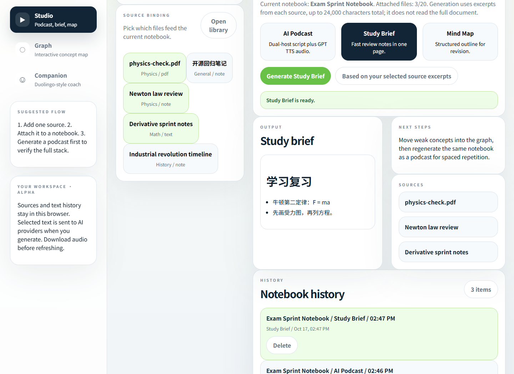

# 小理 · AI 学习工作台

网页版：[打开学习工作台](https://xiaoli-ai-brain-wittlud7.youngcoin22.chatgpt.site)（站点所有者登录后使用）。支持资料导入和 Gemini 学习工具，线上语音合成暂未启用；数据保存在当前浏览器。部署与更新见 [hosting/README.md](hosting/README.md)。

把“资料 → 理解 → 复习”连起来的中文个人学习工具。本地保存资料、记录和音频；生成时才把选定内容发送给你配置的模型。

**v0.2.0-beta.1 · MIT 开源 · 适合个人或少量受信任用户。**



[查看手机宽度截图](docs/images/mobile.png)

## 这版做了什么

- 导入带文字层的 PDF、TXT、Markdown，或直接写笔记；创建、重命名和删除笔记本。
- 从整份资料分段检索相关内容，生成带原文引用的复习摘要；点击 `R1` 等编号检查原文快照。
- 生成真实资料中的概念和关系，在概念图里标记掌握情况。
- 生成记忆卡，先回忆再翻看答案，按回忆结果安排下次复习。
- 生成双人播客脚本，再按需合成语音；音频保存到本浏览器，刷新后可再次播放或下载。
- 对学习记录继续提问，始终检索该记录的原始资料；不会串到当前新选中的笔记本。
- 使用 IndexedDB 事务保存工作区与音频；多标签页检测版本冲突，支持旧版数据迁移、JSON 备份与损坏数据恢复导出。

没有预设图谱、虚构积分或学习连续天数。首次打开是空工作区，可主动添加示例资料。

## 启动

需要 **Node.js 22.13+** 与 npm，推荐 Node.js 22 或 24。

```sh
npm ci
```

创建本机配置文件：

```powershell
# Windows PowerShell
Copy-Item .env.example .env
```

```sh
# macOS / Linux
cp .env.example .env
```

在 `.env` 中填写模型密钥：

```dotenv
# Gemini 文本模型；也可以选择 Anthropic，见下方配置表
GEMINI_API_KEY=你的密钥
# 播客语音可选，不填写仍可阅读脚本
OPENAI_API_KEY=你的密钥
```

```sh
npm start
```

打开 [本地工作台](http://127.0.0.1:3000)。开发时可用 `npm run dev` 自动重启服务。未配置模型也能整理资料、查看历史、复习已有卡片和备份；界面会显示配置状态，不自动生成假结果。

## 使用流程

1. 导入资料或写笔记；首次添加会创建一个笔记本。
2. 勾选当前笔记本的资料，按需填写“这次想学会什么”。
3. 选择摘要、概念图、记忆卡或播客，再生成。
4. 点击原文编号核对结果，或在该记录下继续提问。
5. 在“记忆复习”练习卡片；在“数据与设置”定期导出备份。

播客采用两步操作：先生成脚本，确认后点击“合成音频”。语音是 AI 合成，额外调用 OpenAI，可能单独计费。

## 配置

| 变量 | 用途 |
| --- | --- |
| `STUDY_PROVIDER` | `gemini` 或 `anthropic`；留空时优先使用已配置的 Gemini，否则使用 Anthropic |
| `GEMINI_API_KEY` / `GEMINI_MODEL` | Gemini 凭证与模型名，默认模型 `gemini-3-flash-preview` |
| `ANTHROPIC_AUTH_TOKEN` / `ANTHROPIC_MODEL` | 替代文本供应商，默认模型 `claude-sonnet-4-5` |
| `ANTHROPIC_BASE_URL` | 可选的兼容服务地址，只配置你信任的端点 |
| `OPENAI_API_KEY` / `OPENAI_TTS_MODEL` | 播客语音，默认模型 `gpt-4o-mini-tts` |
| `OPENAI_TTS_VOICE_HOST_A/B/FALLBACK` | 主持人与旁白声音，见 `.env.example` |
| `HOST` / `PORT` | 默认只监听 `127.0.0.1:3000` |
| `APP_ACCESS_TOKEN` | 共享工作区的访问口令；设置时至少 24 字符，非本机监听时必填 |
| `PUBLIC_ORIGIN` | HTTPS 代理后的外部来源，例如 `https://study.example.com`，末尾无斜杠 |

模型名可调整。配置状态表示服务器填了相应凭证，**不代表账号权限、余额、网络或模型可用性已经通过检查**。不会因某供应商失败而自动把资料发送给另一家供应商。

本轮验证中，真实 Gemini 的四种生成和追问均通过；当前本机 Anthropic 和 OpenAI 语音配置的请求未成功。通用接口、失败保留、音频存储与播放另有替代供应商测试。详见 [验证记录](docs/VALIDATION.md)。

## 资料、检索与生成的边界

- 每份文件最多 10 MB，提取正文最多 100,000 字符；PDF 最多 100 页。扫描件需先做 OCR，复杂排版可能影响文字顺序。
- 工作区最多 200 份资料、100 个笔记本，每个笔记本关联最多 20 份资料；一次生成的选中正文合计最多 60 万字符。
- 检索会检查整份资料的各个片段；中文使用双字词匹配，结合学习目标或问题选择片段。没有目标时兼顾开头、结尾与中间位置。
- 每次最多发送 24 段、约 22,000 字符；这不是向量数据库，也不等于模型读过全部内容。同义词、图表和跨段推理可能检索不足。
- 服务端检查生成结构、概念关系和引用编号；**编号有效不等于事实正确或引文足以支持结论**，请自行核对原文。
- 每个笔记本最多保存 30 条记录，满后需主动清理；不自动覆盖旧结果。每条记录保存最近 10 轮追问。
- 删除资料后，已有引用快照保留；原始资料缺失或发生变化时，该旧记录的追问会停用，避免混用来源。

记忆卡使用简单的间隔计划：“忘记了”10 分钟后再练；其他结果按已有间隔延长。它不是经个体校准的记忆模型或学习效果保证。

## 数据与升级

工作区与音频保存在当前站点的浏览器 IndexedDB，没有云端账号或跨设备同步。不同浏览器、端口和域名相互独立。清理浏览器站点数据会删除本地记录。

JSON 备份包含原始资料、学习记录、引用、对话和复习进度，最多 24 MB；不包含音频与访问口令。音频需从播放器单独下载，每条最多 25 MB。

从 v0.1 升级时，首次打开同一站点会尝试迁移旧 localStorage 数据，原始键不会被删除。旧版未解析的 PDF 只能保留占位记录，需重新导入原文件。详见 [迁移与恢复](docs/MIGRATION.md)。

## 本地与公网访问

默认只开放本机。局域网使用需设置 `HOST=0.0.0.0` 和至少 24 字符的随机 `APP_ACCESS_TOKEN`；首次请求时在界面输入这个口令。口令仅保留在页面内存，刷新后清除；它不同于供应商 API 密钥。

公网请使用 HTTPS 反向代理，并设置准确的 `PUBLIC_ORIGIN`。服务不信任代理提供的客户端 IP，因此代理后的用户共享限流额度。默认每 IP 每分钟 20 次 API 请求、全局最多同时生成 2 个请求。上游请求有超时和取消，失败不会透传原始错误内容。

这仍是个人工具，尚无多租户隔离、按用户计费或分布式限流。请配合供应商预算限制使用，参见 [安全说明](SECURITY.md)。

## 开发、检查与发布包

在源码目录运行：

```sh
npm run check
npx playwright install chromium
npm run test:browser
```

`check` 包括格式、语法、常见凭证扫描、领域/API/存储测试与打包。浏览器测试覆盖真实 DOM、IndexedDB、PDF 导入、跨标签页、竞态、取消、播放与恢复，使用确定性替代供应商，不产生 API 费用。

`npm run build` 生成 `dist/` 运行包；没有前端编译步骤。运行包排除 `.env`、历史原型、测试和本地输出。将其复制到独立部署目录，再执行 `npm ci --omit=dev`，配置 `.env` 并运行 `npm start`。不要把长期部署的配置保存在会重新生成的 `dist/` 中。

CI 在 Windows/Linux、Node.js 22/24 上检查源码与发布包，并另跑 Chromium 浏览器测试。应用需要 Node.js 服务，不能直接部署到 GitHub Pages。

## 代码结构

```text
server.mjs       API、安全边界、供应商调用、静态资源
lib/study.mjs    资料分段、检索、结构化生成与引用校验
lib/speech.mjs   主持人识别与语音切分
web/model.js    工作区模型、校验、迁移与复习计划
web/storage.js  IndexedDB 事务、版本冲突与音频持久化
web/app.js      操作流程、请求生命周期与上下文归属
web/views.js    中文界面；播放器独立于页面重绘
test/           领域、API、存储回归测试
e2e/            真实浏览器流程测试
fixtures/       仅测试使用的替代供应商
legacy/         历史 React 原型，不维护、不用于部署
```

参与开发请看 [贡献指南](CONTRIBUTING.md)，发布步骤见 [RELEASING](docs/RELEASING.md)，本轮目标与证据见 [重构验收](docs/REBUILD.md)。

## 许可证

代码采用 [MIT](LICENSE)。第三方依赖保留各自许可证；模型、声音与生成内容还受所选供应商条件约束。请只导入、公开你有权使用的资料。
